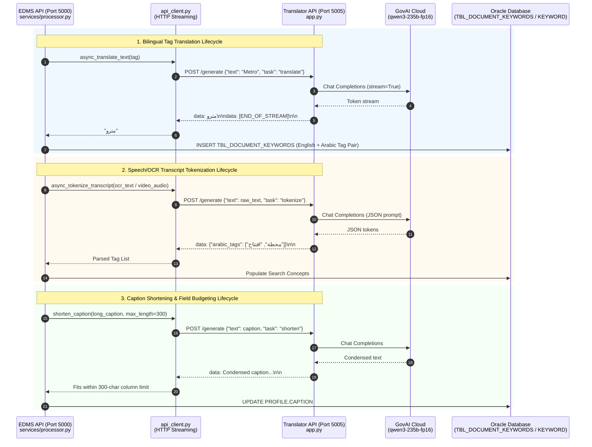

# 🌐 Bilingual AI Translation, Rephrasing & Tokenization Service

[](https://www.microsoft.com/windows-server)
[](https://www.python.org/)
[-009688?logo=fastapi&logoColor=white)](https://fastapi.tiangolo.com/)
[-499848?logo=gunicorn&logoColor=white)](https://www.uvicorn.org/)
[](https://llmapi.govai.ae)
[](http://localhost:5005)

High-performance bilingual (**Arabic & English**) text translation, contextual stylistic rephrasing, and search tag tokenization microservice built with **FastAPI** and **Uvicorn**, powered by **GovAI's Enterprise LLM** (`qwen3-235b-fp16`).

The service serves a critical dual role:
1. **Interactive Web Assistant:** A responsive web application with dynamic Arabic/English typography, character-by-character live streaming, and single-click alternatives.
2. **Dedicated Language Engine for Smart EDMS:** Operating as the linguistic middleware for the **EDMS API** ([..\EDMS API](file:///d:/projects/new%20EDMS%20py/EDMS%20API)), enabling bidirectional tag translation, speech transcript tokenization, and caption length condensation before database persistence.

The service is fully packaged for **air-gapped Windows environments**, runs natively under **Windows Server IIS** via `HttpPlatformHandler` on port `5005`, and features strict Arabic diacritics stripping (Tashkeel normalization) to power cross-lingual search.

---

## 📑 Table of Contents

- [System Architecture](#system-architecture)
- [How This Project Uses GovAI LLM](#how-this-project-uses-govai-llm)
  - [Model Selection & Rationale (`qwen3-235b-fp16`)](#model-selection--rationale-qwen3-235b-fp16)
  - [Streaming SSE Protocol (`POST /generate`)](#streaming-sse-protocol-post-generate)
  - [Translation Pipeline (`translate`) & Bi-directional Auto-Detection](#translation-pipeline-translate--bi-directional-auto-detection)
  - [Search Concept Tokenization Pipeline (`tokenize`)](#search-concept-tokenization-pipeline-tokenize)
  - [Contextual Editorial Rephrasing Pipeline (`rephrase`)](#contextual-editorial-rephrasing-pipeline-rephrase)
  - [Arabic Diacritics Normalization & Tashkeel Stripping (`clean_response`)](#arabic-diacritics-normalization--tashkeel-stripping-clean_response)
  - [Error Handling & Stream Resiliency](#error-handling--stream-resiliency)
- [Integration with EDMS API (`..\EDMS API`)](#integration-with-edms-api-edms-api)
  - [Architectural Role in Smart EDMS](#architectural-role-in-smart-edms)
  - [Sequence Diagram & Request Lifecycle](#sequence-diagram--request-lifecycle)
  - [Network & Configuration Binding](#network--configuration-binding)
  - [Bilingual Tag Translation & Cross-Lingual Search Bridging](#bilingual-tag-translation--cross-lingual-search-bridging)
  - [Video Transcript & OCR Tokenization](#video-transcript--ocr-tokenization)
  - [Caption Shortening & Oracle Database Budgeting](#caption-shortening--oracle-database-budgeting)
  - [Streaming Client Protocol (`api_client.py`)](#streaming-client-protocol-api_clientpy)
- [Web User Interface](#web-user-interface)
  - [Interface Architecture & UX Flow](#interface-architecture--ux-flow)
  - [Dynamic RTL/LTR Typography Alignment](#dynamic-rtlltr-typography-alignment)
  - [Mid-Stream Cancellation & Regenerate Alternatives](#mid-stream-cancellation--regenerate-alternatives)
- [Project Architecture & Code Graph Analysis (`graphify-out`)](#project-architecture--code-graph-analysis-graphify-out)
  - [Directory Tree](#directory-tree)
  - [Code Graph Summary (`graphify-out`)](#code-graph-summary-graphify-out)
  - [Core Abstractions (God Nodes)](#core-abstractions-god-nodes)
  - [Module Communities & Structural Topology](#module-communities--structural-topology)
- [API Reference](#api-reference)
  - [`POST /generate`](#post-generate)
  - [`GET /`](#get-)
  - [Status & Streaming Event Matrix](#status--streaming-event-matrix)
- [Configuration & Environment Variables](#configuration--environment-variables)
- [Deployment & Operational Scripts](#deployment--operational-scripts)
  - [Production Windows Server IIS Deployment (`web.config`)](#production-windows-server-iis-deployment-webconfig)
  - [One-Click Offline Setup (`setup.bat` & `install_packages.bat`)](#one-click-offline-setup-setupbat--install_packagesbat)
  - [Local Standalone Server (`run.bat`)](#local-standalone-server-runbat)
  - [Offline Dependency Downloading (`download_packages.bat`)](#offline-dependency-downloading-download_packagesbat)
  - [Automated Deployment Packaging (`create_archive.bat` & `archive_helper.ps1`)](#automated-deployment-packaging-create_archivebat--archive_helperps1)
  - [Troubleshooting & Operational Runbook](#troubleshooting--operational-runbook)

---

## System Architecture

```mermaid
flowchart TD
    Client["Client / EDMS API<br/>(Port 5000)"] -->|POST /generate<br/>JSON: text + task| Gateway["FastAPI Server<br/>(Port 5005)"]
    WebUser["Web Browser User"] -->|POST /generate<br/>JSON: text + task| Gateway
    WebUser -->|GET /<br/>HTML & Static Assets| Gateway

    Gateway --> Router{"Route Task Type"}

    subgraph TaskHandlers ["Task Prompt Synthesizers"]
        Router -->|task = 'translate'| LangDetect["is_arabic()<br/>Detect Source Lang"]
        LangDetect --> TransPrompt["Build Direct Translation Prompt<br/>Strict Zero-Tashkeel + No Filler"]
        
        Router -->|task = 'tokenize'| TokPrompt["Build JSON Extraction Prompt<br/>Output: {'arabic_tags'|'english_tags': []}"]
        
        Router -->|task = 'rephrase'| RephrasePrompt["Build Editorial Rewrite Prompt<br/>Preserve Meaning & Language"]
        
        Router -->|task = other / 'shorten'| DefaultPrompt["Build Default / Summarization Prompt"]
    end

    TransPrompt --> GovAIPayload["Construct OpenAI Chat Payload<br/>Model: qwen3-235b-fp16<br/>Temperature: 0.3 | Stream: True"]
    TokPrompt --> GovAIPayload
    RephrasePrompt --> GovAIPayload
    DefaultPrompt --> GovAIPayload

    subgraph GovAICloud ["GovAI Cloud Platform"]
        GovAIPayload --> GovAICall["POST https://llmapi.govai.ae/chat/completions<br/>Authorization: Bearer sk-..."]
        GovAICall -->|SSE Stream: data: {...}| SSEChunk["Stream Raw Token Deltas"]
    end

    subgraph StreamCleaning ["Linguistic Normalization Engine"]
        SSEChunk --> CleanFilter["clean_response()<br/>1. Strip Arabic Tashkeel [\\u064B-\\u065F\\u0670]<br/>2. Suppress Stray Question Marks '?'"]
        CleanFilter --> FormatSSE["Format Event Stream<br/>'data: {cleaned}\\n\\n'"]
    end

    FormatSSE --> EndOfStream{"[DONE] Signal?"}
    EndOfStream -->|No| Gateway
    EndOfStream -->|Yes| Terminate["data: [END_OF_STREAM]\\n\\n"]
    Terminate --> Gateway
    Gateway -->|text/event-stream| Client
    Gateway -->|text/event-stream| WebUser
```

---

## How This Project Uses GovAI LLM

[app.py](file:///d:/projects/new%20EDMS%20py/Translator%20Rephraser%20py/app.py) integrates directly with the **GovAI LLM API** (`https://llmapi.govai.ae/chat/completions`), an enterprise AI inference platform hosting sovereign large language models.

### Model Selection & Rationale (`qwen3-235b-fp16`)

The service utilizes the flagship `qwen3-235b-fp16` model:
- **Massive Parameter Scale (235B):** Provides nuanced bilingual command of Classical Arabic, Modern Standard Arabic (MSA), and complex administrative/governmental terminology.
- **Unquantized FP16 Weights:** Avoids the token corruption, misread grammatical endings, and repetitive generation patterns often seen in 4-bit or 8-bit quantized models.
- **Superior Structured Output Compliance:** Faithfully respects negative prompting (e.g., zero diacritics) and strict JSON schema generation (`{"arabic_tags": []}`) without leaking markdown wrappers.

### Streaming SSE Protocol (`POST /generate`)

To guarantee immediate responsiveness and avoid gateway timeouts on long paragraphs, all generation is streamed end-to-end:
1. **FastAPI Route:** [app.py:generate](file:///d:/projects/new%20EDMS%20py/Translator%20Rephraser%20py/app.py#L136-L196) dispatches requests with `stream=True`.
2. **Upstream Streaming Consumption:** It reads byte lines from GovAI using `response.iter_lines()` and inspects lines beginning with `data: `.
3. **OpenAI Protocol Unpacking:** Parses JSON deltas:
   ```python
   chunk = json.loads(data_str)
   delta = chunk.get("choices", [])[0].get("delta", {})
   content = delta.get("content", "")
   ```
4. **On-The-Fly Diacritics Sanitization:** Cleans each token delta before yielding down the wire to the caller.
5. **Stream Delimiters:** Emits standard `data: <cleaned_chunk>\n\n`, followed by `data: [END_OF_STREAM]\n\n` upon completion or `data: [ERROR]\n\n` upon failure.

---

### Translation Pipeline (`translate`) & Bi-directional Auto-Detection

The translation pipeline in [app.py:create_messages](file:///d:/projects/new%20EDMS%20py/Translator%20Rephraser%20py/app.py#L66-L133) provides automatic, frictionless language switching:

1. **Automatic Language Detection (`is_arabic`):**
   ```python
   def is_arabic(text):
       if not text or not isinstance(text, str):
           return False
       return bool(re.search('[\u0600-\u06FF]', text))
   ```
   If Arabic Unicode characters are detected, the target language becomes **English**; otherwise, the target language becomes **Arabic**.

2. **Negative Prompting Constraints:**
   When targeting Arabic, the model is bound by strict constraints:
   - **Zero Diacritics (Tashkeel):** Diacritics are strictly forbidden to ensure clean database indexing and exact string matching.
   - **No Stray Question Marks:** Prohibits hallucinated punctuation.
   - **No Conversational Wrapper:** Introductory phrases ("Here is the translation:") and markdown commentary are suppressed.
   - **Word Completeness:** Mandates translating every single word into the target language.

---

### Search Concept Tokenization Pipeline (`tokenize`)

When processing unstructured text (such as extracted OCR text or video audio transcripts from EDMS), the service operates in **JSON Output Machine Mode**:

- **System Instruction:** `"You are a JSON output machine. Your only function is to output a specific JSON structure."`
- **Extraction Rules:**
  1. Extracts key nouns, named entities, and conceptual topics suitable for database search tags.
  2. Enforces monolingual tags matching the detected language: `{"arabic_tags": [...]}` or `{"english_tags": [...]}`.
  3. Corrects OCR/ASR typos and standardizes enterprise abbreviations (e.g., "RTA", "Metro").
  4. Purges all stopwords, non-essential words, and duplicates.
  5. Outputs strictly the raw JSON structure without markdown code fences (` ``` `).

---

### Contextual Editorial Rephrasing Pipeline (`rephrase`)

For business communications and document descriptions, the `rephrase` task provides professional editorial rewriting:

- **Goal:** Rewrites text to be clearer, more concise, and more professional while strictly preserving the original meaning.
- **Language Lock:** Explicitly retains the source language without translating.
- **Clean Output:** Prohibits conversational filler and strips Tashkeel from Arabic outputs.

---

### Arabic Diacritics Normalization & Tashkeel Stripping (`clean_response`)

Arabic diacritics (*Tashkeel*: Fatha, Damma, Kasra, Sukun, Tanwin, Shadda) drastically degrade database search recall: a user querying `"محمد"` will not match records stored with Tashkeel `"مُحَمَّد"`.

[app.py:clean_response](file:///d:/projects/new%20EDMS%20py/Translator%20Rephraser%20py/app.py#L53-L64) enforces double-layer normalization:

```python
def clean_response(text):
    """
    Removes all Arabic diacritics (Tashkeel) and stray question marks.
    """
    if not text:
        return text
    
    # Matches Unicode ranges for Tashkeel: Fathatan, Dammatan, Kasratan, Fatha, Damma, Kasra, Shadda, Sukun, Superscript Alef
    arabic_diacritics = re.compile(r'[\u064B-\u065F\u0670]')
    cleaned_text = re.sub(arabic_diacritics, '', text)
    cleaned_text = cleaned_text.replace('?', '')
    
    return cleaned_text
```

This guarantees 100% normalized Arabic text across all streaming deltas.

---

### Error Handling & Stream Resiliency

GovAI calls are protected against network drops and unexpected token payloads:
- A 120-second timeout prevents worker hangs.
- Catching `requests.exceptions.RequestException` logs the underlying issue and yields `data: [ERROR]\n\n`, allowing client frontends and the EDMS API to handle the exception gracefully without infinite polling.

---

## Integration with EDMS API (`..\EDMS API`)

This service is a foundational linguistic component of the broader **Smart EDMS** ecosystem. The parent directory contains the primary backend application: [..\EDMS API](file:///d:/projects/new%20EDMS%20py/EDMS%20API).



### Architectural Role in Smart EDMS

In Smart EDMS, whenever visual or textual data is ingested:
1. **Cross-Lingual Tag Synchronization:** Deep learning models (such as the Image Captioning service or Face Recognition) generate English visual tags. The EDMS background worker calls `api_client.translate_text` to automatically synthesize Arabic equivalents.
2. **Manual Tag Provisioning:** When administrators create tags in the portal ([routes/tags.py](file:///d:/projects/new%20EDMS%20py/EDMS%20API/routes/tags.py)), typing an Arabic tag automatically generates the English counterpart and vice versa.
3. **Speech & Document Tokenization:** Audio transcriptions extracted from media files ([services/processor.py](file:///d:/projects/new%20EDMS%20py/EDMS%20API/services/processor.py)) are tokenized into keyword entities via `api_client.tokenize_transcript`.
4. **Caption Length Budgeting:** Captions generated by Vision LLMs often exceed the 300-character constraint of legacy Oracle database columns (`PROFILE.CAPTION`). `api_client.shorten_caption` condenses lengthy descriptions while preserving semantic context.

### Network & Configuration Binding

In [..\EDMS API\.env](file:///d:/projects/new%20EDMS%20py/EDMS%20API/.env) and [..\EDMS API\web2.config](file:///d:/projects/new%20EDMS%20py/EDMS%20API/web2.config):
```ini
TRANSLATOR_REPHRASER_API_URL="http://localhost:5005"
```

### Bilingual Tag Translation & Cross-Lingual Search Bridging

When tags are created in [routes/tags.py:create_tag](file:///d:/projects/new%20EDMS%20py/EDMS%20API/routes/tags.py#L30-L50):
```python
if is_arabic:
    name_arabic = data.name
    name_english = api_client.translate_text(name_arabic)
else:
    name_english = data.name
    name_arabic = api_client.translate_text(name_english) or None
```
Both `NAME_ARABIC` and `NAME_ENGLISH` are committed to the Oracle database. When end users search for `"Dubai Metro"` or `"مترو دبي"`, the system guarantees identical recall across both languages.

### Video Transcript & OCR Tokenization

During asynchronous document processing in [services/processor.py](file:///d:/projects/new%20EDMS%20py/EDMS%20API/services/processor.py#L276):
```python
tokenized_json_str = await async_tokenize_transcript(video_summary['transcript'])
```
The tokenized tags are parsed, deduplicated, and inserted into `TBL_DOCUMENT_KEYWORDS` to make video dialogue fully searchable.

### Caption Shortening & Oracle Database Budgeting

If a Vision LLM returns an extensive caption, [api_client.py:shorten_caption](file:///d:/projects/new%20EDMS%20py/EDMS%20API/api_client.py#L93-L128) prompts the service to summarize the text to under 300 characters. If the network is unreachable, it cleanly falls back to word-boundary truncation without breaking word tokens.

### Streaming Client Protocol (`api_client.py`)

[api_client.py:translate_text](file:///d:/projects/new%20EDMS%20py/EDMS%20API/api_client.py#L216-L232) consumes the SSE stream directly:
```python
def translate_text(text):
    """Calls the translator/rephraser API to translate text."""
    api_url = os.getenv("TRANSLATOR_REPHRASER_API_URL")
    payload = {"text": text, "task": "translate"}
    response = requests.post(f"{api_url}/generate", json=payload, timeout=300, stream=True)
    response.raise_for_status()

    result_text = ""
    for line in response.iter_lines():
        if line:
            decoded_line = line.decode('utf-8')
            if decoded_line.startswith('data: '):
                data = decoded_line[6:]
                if data.strip() == '[END_OF_STREAM]':
                    break
                result_text += data
    return result_text
```

---

## Web User Interface

The service provides a built-in, responsive web application served directly from `GET /` using **Jinja2** templates ([templates/index.html](file:///d:/projects/new%20EDMS%20py/Translator%20Rephraser%20py/templates/index.html)) and vanilla CSS/JS ([static/style.css](file:///d:/projects/new%20EDMS%20py/Translator%20Rephraser%20py/static/style.css) and [static/script.js](file:///d:/projects/new%20EDMS%20py/Translator%20Rephraser%20py/static/script.js)).

### Interface Architecture & UX Flow

- **Zero-Dependency Modern Frontend:** Built with vanilla JavaScript, modern CSS flexbox/grid, and Google Fonts (`Inter`).
- **Interactive Action Buttons:**
  - `Translate`: Auto-detects language and generates cross-lingual translations.
  - `Rephrase`: Rewrites text in the same language with enhanced clarity.
  - `Tokenize`: Extracts search tag candidates into structured JSON.
- **Dynamic Typing Animation:** SSE tokens stream into the DOM character-by-character, providing instant visual feedback.

### Dynamic RTL/LTR Typography Alignment

The frontend automatically detects Arabic Unicode characters and dynamically applies `.arabic-text`:
- Right-to-Left (RTL) text direction.
- Increased font size (1.1rem) and line height (1.8) tailored for Arabic typography.
- For translation tasks, the target card inverts alignment (English input -> RTL output card; Arabic input -> LTR output card).

### Mid-Stream Cancellation & Regenerate Alternatives

- **Cancellable Requests:** Clicking **"Stop Generating"** triggers the browser's native `AbortController`, closing the HTTP connection and restoring UI controls immediately.
- **Single-Click Alternatives:** Every result card contains a **Regenerate** button (`.regenerate-btn`) allowing users to request alternative phrasings with a single click.

---

## Project Architecture & Code Graph Analysis (`graphify-out`)

### Directory Tree

```
Translator Rephraser py/
├── .env                     # GovAI API URL, Model ID, and API Bearer Token
├── app.py                   # FastAPI application, GovAI streaming logic & prompt routing
├── requirements.txt         # Minimal production dependencies (FastAPI, Uvicorn, Jinja2, Requests)
│
├── static/                  # Static assets for the web user interface
│   ├── script.js            # Frontend SSE client, state management & AbortController logic
│   └── style.css            # Responsive styles, modern cards & Arabic RTL typography
│
├── templates/               # Jinja2 HTML templates
│   └── index.html           # Main user interface view
│
├── packages/                # Offline Python wheel store for air-gapped production deployment
├── logs/                    # Standard output/error logs from IIS HttpPlatformHandler
│
├── web.config               # Microsoft IIS HttpPlatformHandler configuration (Port 5005)
├── setup.bat                # Automated one-click offline venv creator & dependency installer
├── install_packages.bat     # Fast offline pip wheel install helper
├── run.bat                  # Local production launch script (Uvicorn 4 workers on Port 5005)
├── download_packages.bat    # Online utility to download dependencies into packages/
├── create_archive.bat       # Deployment packaging script (creates timestamped zip)
├── archive_helper.ps1       # PowerShell archiving engine (filters git non-ignored files)
│
└── graphify-out/            # Knowledge graph & structural dependency analysis
    ├── GRAPH_REPORT.md      # Summary of graph nodes, edges, and community hubs
    ├── graph.html           # Interactive visual dependency graph explorer
    ├── graph.json           # Raw node-edge graph data (extracted via AST)
    └── manifest.json        # Graph metadata and checksums
```

### Code Graph Summary (`graphify-out`)

Static code structure and call-graph analysis generated by Graphify:
- **Corpus Size:** 4 active files, ~1,994 words.
- **Graph Topology:** 24 nodes, 23 structural edges, 7 distinct communities.
- **Extraction Mode:** 100% Extracted via AST analysis, 0% inferred or ambiguous.

### Core Abstractions (God Nodes)

The code graph identifies the most connected abstractions that govern execution:
1. [app.py:generate](file:///d:/projects/new%20EDMS%20py/Translator%20Rephraser%20py/app.py#L136-L196) (4 edges): Central streaming controller managing GovAI dispatch, SSE chunking, and HTTP streaming.
2. [app.py:create_messages](file:///d:/projects/new%20EDMS%20py/Translator%20Rephraser%20py/app.py#L66-L133) (3 edges): Prompt engineering engine tailoring system and user instructions for `translate`, `tokenize`, and `rephrase`.
3. [app.py:is_arabic](file:///d:/projects/new%20EDMS%20py/Translator%20Rephraser%20py/app.py#L47-L51) (3 edges): Unicode range evaluator for bidirectional language routing.
4. [app.py:clean_response](file:///d:/projects/new%20EDMS%20py/Translator%20Rephraser%20py/app.py#L53-L64) (2 edges): Linguistic post-processing filter purging Arabic Tashkeel diacritics.
5. [app.py:GenerateRequest](file:///d:/projects/new%20EDMS%20py/Translator%20Rephraser%20py/app.py#L42-L45) (3 edges): Pydantic request schema for API validation.
6. [app.py:index](file:///d:/projects/new%20EDMS%20py/Translator%20Rephraser%20py/app.py#L199-L202) (3 edges): Jinja2 template renderer bridging HTTP web traffic.

### Module Communities & Structural Topology

- **Community 0 (API Routing & GovAI Processing):** `app.py`, `generate()`, `create_messages()`, `is_arabic()`, `clean_response()`, `GenerateRequest`.
- **Community 1 (Web Interface & Client Experience):** `templates/index.html`, `static/script.js`, `static/style.css`.
- **Community 2 (Air-Gapped Operations & Deployment):** `setup.bat`, `install_packages.bat`, `run.bat`, `download_packages.bat`, `create_archive.bat`, `archive_helper.ps1`.
- **Community 5 (Template Engine & HTTP Entrypoint):** `index()`, `Request`, `Jinja2Templates`.

---

## API Reference

Base URL: `http://localhost:5005` (Default port)

### `POST /generate`

Primary streaming generation endpoint. Accepts JSON describing the input text and the target task, and streams Server-Sent Events (SSE) tokens back to the caller.

- **URL:** `/generate`
- **Method:** `POST`
- **Headers:** `Content-Type: application/json`
- **Request Body (JSON):**
  ```json
  {
    "text": "The Dubai Metro is a rapid transit rail network in the city of Dubai.",
    "task": "translate"
  }
  ```

| Field | Type | Required | Default | Description |
| :--- | :--- | :--- | :--- | :--- |
| `text` | string | **Yes** | — | Input text to translate, rephrase, or tokenize |
| `task` | string | No | `"translate"` | Target operation: `"translate"`, `"rephrase"`, or `"tokenize"` |

- **Response:** `200 OK`
- **Response Headers:** `Content-Type: text/event-stream; charset=utf-8`
- **Response Format (Server-Sent Events):**
  ```
  data: مترو

  data:  دبي

  data:  هو

  data:  شبكة

  data:  سكك

  data:  حديدية

  data: [END_OF_STREAM]

  ```

#### Example using `curl` (Live Streaming Output):

```bash
curl -N -X POST http://127.0.0.1:5005/generate \
  -H "Content-Type: application/json" \
  -d '{"text": "Artificial Intelligence is transforming electronic document management.", "task": "translate"}'
```

#### Example in Python (Streaming Consumer):

```python
import json
import requests

url = "http://127.0.0.1:5005/generate"
payload = {
    "text": "The Dubai Metro is expanding with new stations.",
    "task": "translate"
}

response = requests.post(url, json=payload, stream=True, timeout=120)
response.raise_for_status()

full_text = []
for line in response.iter_lines():
    if line:
        decoded_line = line.decode("utf-8")
        if decoded_line.startswith("data: "):
            data = decoded_line[6:]
            if data.strip() == "[END_OF_STREAM]":
                break
            if data.strip() == "[ERROR]":
                raise RuntimeError("Server generation error.")
            full_text.append(data)

translated_result = "".join(full_text)
print("Result:", translated_result)
```

---

### `GET /`

Renders the interactive web application user interface.

- **URL:** `/`
- **Method:** `GET`
- **Response:** `200 OK` (`text/html`)

---

### Status & Streaming Event Matrix

| Event Signal / HTTP Status | Meaning | Recovery / Handling |
| :--- | :--- | :--- |
| `HTTP 200 OK` | Request accepted; stream initiated | Consume SSE lines until `[END_OF_STREAM]` |
| `data: <content>\n\n` | Text delta chunk from GovAI | Append to accumulator / DOM element |
| `data: [END_OF_STREAM]\n\n` | Normal stream termination | Close HTTP connection; finalize output |
| `data: [ERROR]\n\n` | Upstream GovAI failure or timeout | Display error banner or activate fallback |
| `HTTP 422 Unprocessable Entity` | Invalid JSON body or missing `text` | Correct request payload schema |
| `HTTP 502 / 504 (via IIS)` | Service backend down or timeout | Verify Uvicorn process in Task Manager |

---

## Configuration & Environment Variables

Settings are configured in [.env](file:///d:/projects/new%20EDMS%20py/Translator%20Rephraser%20py/.env) and loaded at startup via `python-dotenv`:

| Variable Name | Example Value | Description |
| :--- | :--- | :--- |
| `GOVAI_API_URL` | `https://llmapi.govai.ae/chat/completions` | Upstream OpenAI-compatible chat completions endpoint |
| `GOVAI_MODEL` | `qwen3-235b-fp16` | Sovereign enterprise large language model identifier |
| `GOVAI_API_KEY` | `sk-913h9...` | GovAI Bearer authentication token |
| `HTTP_PLATFORM_PORT` | `5005` | Dynamic internal port assigned automatically by Windows IIS (defaults to `5005` in standalone mode) |

---

## Deployment & Operational Scripts

### Production Windows Server IIS Deployment (`web.config`)

In production Windows Server environments, this service runs under **Microsoft IIS** using the **HttpPlatformHandler** module (configured in [web.config](file:///d:/projects/new%20EDMS%20py/Translator%20Rephraser%20py/web.config)).

**Key Features of IIS Integration:**
- **No FastCGI Bottleneck:** Uses `HttpPlatformHandler` to supervise a native Uvicorn ASGI child process directly.
- **Dynamic Port Assignment:** IIS assigns a dynamic internal port via `%HTTP_PLATFORM_PORT%` while binding external traffic to port `5005`.
- **Automatic Process Supervision:** Automatically restarts crashed worker instances (`startupRetryCount="3"`, `requestTimeout="00:20:00"`).
- **Log Routing:** Captures stdout and stderr streams into `.\logs\python-stdout.log`.

**IIS Setup Steps:**
1. Open **IIS Manager**, right-click **Sites**, and select **Add Website**.
2. Set **Site Name** to `Translator_Rephraser_API`.
3. Set **Physical Path** to `D:\projects\new EDMS py\Translator Rephraser py` (or your target production directory).
4. Set the **Site Binding** to `http://*:5005`.
5. Ensure the IIS Application Pool identity (`IIS_IUSRS` / `AppPoolIdentity`) has **Read & Execute** permissions on the project directory, and **Write** permissions on `logs\`.

---

### One-Click Offline Setup (`setup.bat` & `install_packages.bat`)

Designed for secure, air-gapped production servers with zero internet access:
```cmd
setup.bat
```
What it does:
1. Purges any stale `venv\` directory to guarantee a pristine installation.
2. Creates a clean Python virtual environment (`python -m venv venv`).
3. Installs all required wheels completely offline from `packages\`:
   ```cmd
   pip install --no-index --find-links=packages -r requirements.txt
   ```
4. Creates necessary runtime directories (`logs\`).

Alternatively, [install_packages.bat](file:///d:/projects/new%20EDMS%20py/Translator%20Rephraser%20py/install_packages.bat) can be executed directly to perform the exact same offline installation steps.

---

### Local Standalone Server (`run.bat`)

To start the API in standalone mode outside of IIS:
```cmd
run.bat
```
Activates the virtual environment and launches:
```cmd
uvicorn app:app --host 0.0.0.0 --port 5005 --workers 4
```

---

### Offline Dependency Downloading (`download_packages.bat`)

When updating dependencies on an internet-connected build machine before deploying to air-gapped servers:
```cmd
download_packages.bat
```
This utility:
1. Cleans the existing `packages\` directory.
2. Builds binary wheels for all packages in `requirements.txt`.
3. Downloads wheels specifically for **Python 3.12 64-bit** (`win_amd64`) and **Python 3.12 32-bit** (`win32`) to guarantee binary compatibility across server architectures.

---

### Automated Deployment Packaging (`create_archive.bat` & `archive_helper.ps1`)

To generate a production deployment zip package:
```cmd
create_archive.bat
```
What it does:
1. Executes [archive_helper.ps1](file:///d:/projects/new%20EDMS%20py/Translator%20Rephraser%20py/archive_helper.ps1) with PowerShell.
2. Scans files using `git ls-files` to strictly include tracked and untracked non-ignored source files while excluding `.git`, `.gitignore`, `venv`, `__pycache__`, and `logs`.
3. Includes the complete offline wheel cache from `packages\`.
4. Outputs a timestamped release archive in the parent directory:
   ```
   ..\Translator_Rephraser_py_YYYY-MM-DD_HH-mm-ss.zip
   ```

---

### Troubleshooting & Operational Runbook

| Symptom | Probable Cause | Action |
| :--- | :--- | :--- |
| **HTTP 502.3 Bad Gateway on IIS** | Uvicorn process failed to start or crashed | Inspect `logs\python-stdout.log` for Python traceback; verify `venv\Scripts\python.exe` exists |
| **Port 5005 Already in Use** | Another instance or background Uvicorn is bound | Run `netstat -ano \| findstr :5005` in CMD and kill conflicting PID (`taskkill /PID <PID> /F`) |
| **Stream Stops Abruptly** | Client closed connection or GovAI timed out | Check network connectivity to `llmapi.govai.ae`; inspect `logs\python-stdout.log` |
| **`data: [ERROR]` Received** | Invalid `GOVAI_API_KEY` or quota exhausted | Verify `GOVAI_API_KEY` in [.env](file:///d:/projects/new%20EDMS%20py/Translator%20Rephraser%20py/.env) |
| **Tashkeel Present in Output** | Prompt drift from upstream LLM | `clean_response()` regex automatically strips Tashkeel; verify `clean_response` is called on token chunks |
| **Missing `packages` Folder** | Archive extracted without wheels | Run `download_packages.bat` on an online machine, then copy `packages\` to the server |